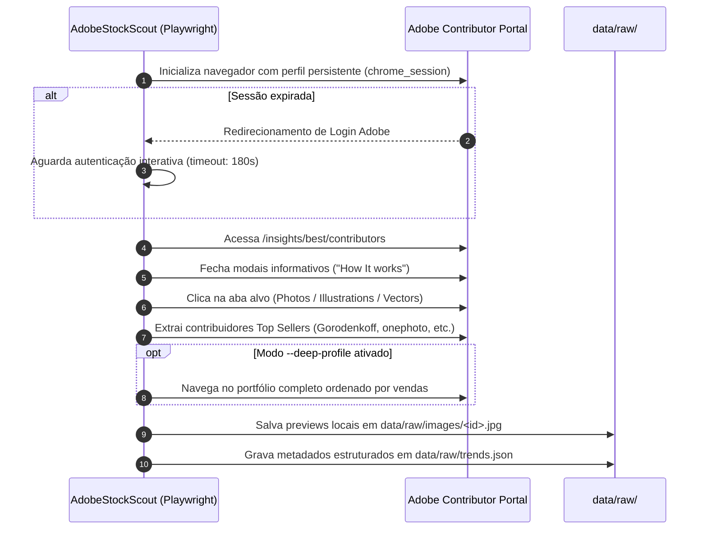
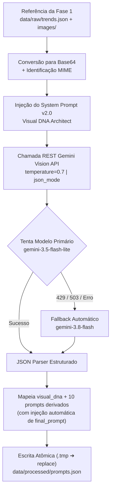
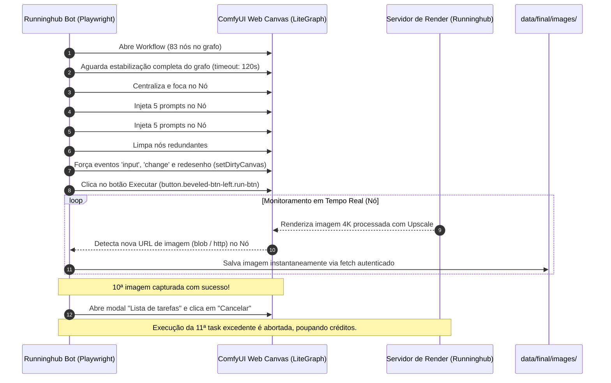
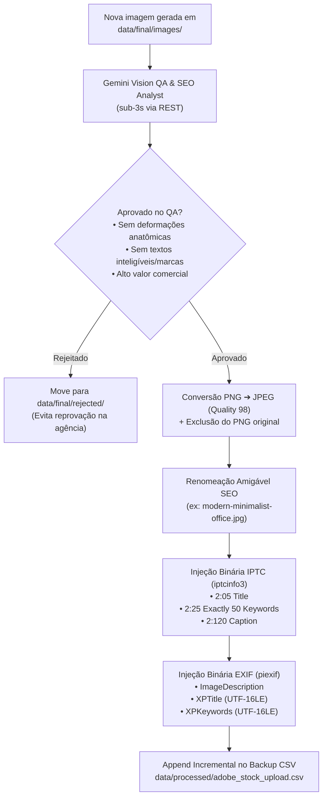

# StockCont 📈🤖

> **Pipeline Autônomo de Engenharia Reversa, Produção Generativa em Massa e Catalogação de Ativos para Microstock.**

[](https://www.python.org/)
[](https://playwright.dev/)
[](https://ai.google.dev/)
[](https://www.runninghub.ai/)
[](https://iptc.org/)
[](LICENSE)

---

## 📑 Sumário Executivo

1. [Visão Geral do Sistema](#-visão-geral-do-sistema)
2. [Arquitetura de Alto Nível & Topologia](#-arquitetura-de-alto-nível--topologia)
3. [Mapa Mental do Ecossistema](#-mapa-mental-do-ecossistema)
4. [Detalhamento Técnico das 4 Fases](#-detalhamento-técnico-das-4-fases)
   - [Fase 1: O Olheiro (Trend Scout & Contributor Insights)](#fase-1-o-olheiro-trend-scout--contributor-insights)
   - [Fase 2: O Diretor de Arte (Visual DNA & Commercial Prompt Architect v2.0)](#fase-2-o-diretor-de-arte-visual-dna--commercial-prompt-architect-v20)
   - [Fase 3: A Fábrica (Runninghub ComfyUI RPA & Upscale 4K)](#fase-3-a-fábrica-runninghub-comfyui-rpa--upscale-4k)
   - [Fase 4: O Catalogador (Multimodal QA, Injeção Binária IPTC/EXIF & CSV)](#fase-4-o-catalogador-multimodal-qa-injeção-binária-iptcexif--csv)
5. [Orquestrador Mestre CLI (`main.py`)](#-orquestrador-mestre-cli-mainpy)
6. [Estrutura do Repositório & Gestão de Dados](#-estrutura-do-repositório--gestão-de-dados)
7. [Contratos de Dados (Data Schemas)](#-contratos-de-dados-data-schemas)
8. [Matriz Estratégica de Monetização Multi-Agência](#-matriz-estratégica-de-monetização-multi-agência)
9. [Instalação, Configuração & Execução](#-instalação-configuração--execução)
10. [Resiliência Operacional & Decisões de Engenharia](#-resiliência-operacional--decisões-de-engenharia)

---

## 🔭 Visão Geral do Sistema

O **StockCont** é uma plataforma de engenharia de dados e produção automatizada projetada para operar o ciclo comercial completo de ativos digitais gerados por inteligência artificial para o mercado global de **microstock** (Adobe Stock, Freepik, Alamy, Vecteezy, entre outros).

Em vez de depender de inspirações aleatórias ou geração manual descentralizada, o StockCont fecha o loop produtivo de ponta a ponta:
1. **Mina** dados reais de demanda de mercado analisando os portfólios dos maiores contribuidores mundiais e tendências de download da Adobe Stock.
2. **Executa Engenharia Reversa Multimodal** da estética dessas referências (iluminação, composição, paleta, física de materiais) via Gemini Vision REST API.
3. **Opera Robôs de Automação (RPA)** no ComfyUI hospedado em nuvem (Runninghub) para injetar lotes de prompts estruturados, disparar a geração em massa e capturar renders em resolução nativa 4K.
4. **Audita Qualidade (QA)**, gera metadados comerciais de alta conversão SEO e **grava binariamente tags IPTC e EXIF** diretamente dentro do arquivo JPG final — garantindo preenchimento automático instantâneo ao subir os arquivos nas plataformas de estoque.

---

## 🏗 Arquitetura de Alto Nível & Topologia

```mermaid
flowchart LR
    subgraph S1["Fase 1: Mineração de Demanda"]
        A1["Adobe Stock Contributor Insights"] --> B1["Playwright Web Scraper<br/>(Sessão Persistente)"]
        B1 --> C1[("data/raw/trends.json<br/>+ data/raw/images/")]
    end

    subgraph S2["Fase 2: Engenharia Reversa Multimodal"]
        C1 --> A2["Gemini Vision REST API<br/>(Visual DNA v2.0)"]
        A2 --> B2["10 Prompts Derivados Comerciais<br/>(Style, Lighting, Final Prompt)"]
        B2 --> C2[("data/processed/prompts.json<br/>(Escrita Atômica .tmp)")]
    end

    subgraph S3["Fase 3: A Fábrica RPA (Runninghub)"]
        C2 --> A3["Playwright ComfyUI Controller"]
        A3 --> B3["Injeção nos Nós #128 e #129<br/>(Limpeza Nós #130 e #131)"]
        B3 --> C3["Monitoramento Nó #192<br/>(Captura 4K Streaming)"]
        C3 --> D3["Cancelamento Preventivo<br/>da Task Excedente"]
        D3 --> E3[("data/final/images/<br/>(Imagens Brutas 4K)")]
    end

    subgraph S4["Fase 4: Catalogação & SEO Binário"]
        E3 --> A4["Gemini Vision QA Reviewer<br/>(Critérios Comerciais & Anatomia)"]
        A4 --> B4["Conversão PNG ➔ JPG 98%<br/>+ Renomeação Amigável SEO"]
        B4 --> C4["Injeção Binária IPTC & EXIF<br/>(iptcinfo3 + piexif)"]
        C4 --> D4[("data/processed/<br/>adobe_stock_upload.csv")]
    end

    S1 --> S2 --> S3 --> S4
```



---

## 🧠 Mapa Mental do Ecossistema

```mermaid
graph TD
    Root["StockCont: Motor Autônomo de Microstock"]

    Root --> M1["1. Inteligência de Mercado"]
    M1 --> M1_1["Contributor Insights Portal"]
    M1 --> M1_2["Métricas Reais de Vendas (Lifetime Downloads)"]
    M1 --> M1_3["Modo Busca por Nicho & Ordem de Downloads"]
    M1 --> M1_4["Deep Profile Portfolio Mining"]

    Root --> M2["2. Engenharia Reversa Visual"]
    M2 --> M2_1["System Prompt v2.0 Visual DNA Architect"]
    M2 --> M2_2["Decomposição em 8 Dimensões Estéticas"]
    M2 --> M2_3["Geração Modular de 10 Prompts por Imagem"]
    M2 --> M2_4["Fallback Dinâmico Gemini Flash-Lite ➔ Flash"]

    Root --> M3["3. Fábrica Generativa (RPA)"]
    M3 --> M3_1["Automação Baseada em DOM + LiteGraph API"]
    M3 --> M3_2["Injeção em Nós de Prompts (#128, #129)"]
    M3 --> M3_3["Extração Streaming 4K no Nó #192"]
    M3 --> M3_4["Cancelamento Autônomo de Task Excedente"]

    Root --> M4["4. Catalogação & Indexação"]
    M4 --> M4_1["Auditoria Automática de QA Visual (Rejeição de Defeitos)"]
    M4 --> M4_2["Geração de 50 Palavras-Chave Ranqueadas + Categoria"]
    M4 --> M4_3["Gravação Física IPTC (2:05, 2:25, 2:120)"]
    M4 --> M4_4["Gravação Física EXIF (XPTitle, XPKeywords)"]
    M4 --> M4_5["Planilha CSV Incremental de Backup"]
```



---

## 🔬 Detalhamento Técnico das 4 Fases

### Fase 1: O Olheiro (*Trend Scout & Contributor Insights*)
* **Módulo Central**: [`src/scraper/adobe_stock.py`](file:///c:/Users/WDAGUtilityAccount/Downloads/Nova%20pasta/src/scraper/adobe_stock.py)
* **Objetivo**: Extrair os ativos e contribuidores mais vendidos do mundo com base em dados reais de conversão do Adobe Stock.



#### Destaques de Engenharia:
* **Sessão Persistente**: Armazena cookies e sessão em `chrome_session/`, evitando a necessidade de login repetido a cada lote.
* **Dois Modos de Operação**:
  1. `insights` (*Default*): Minera dados confidenciais do painel de contribuidores com contadores de vendas vitais (`100,000+ downloads`, `10K+ downloads`).
  2. `search`: Busca pública por palavra-chave e nicho específico, permitindo ordenação por `nb_downloads` (número de downloads) ou `relevance`.
* **Download Assíncrono com Resiliência**: Utiliza `httpx` com sanitização regex de ID e cabeçalhos de navegador para gravação local segura.

---

### Fase 2: O Diretor de Arte (*Visual DNA & Commercial Prompt Architect v2.0*)
* **Módulo Central**: [`src/analyzer/director.py`](file:///c:/Users/WDAGUtilityAccount/Downloads/Nova%20pasta/src/analyzer/director.py)
* **Objetivo**: Efetuar a desconstrução semântica e visual das referências e sintetizar **exatamente 10 prompts derivados comerciais** prontos para produção.



#### Dimensões Analisadas pelo System Prompt v2.0:
1. **Subject & Semantic Structure**: Sujeito principal, narrativa, hierarquia de foco e mensagem comercial.
2. **Artistic Style**: Fotografia comercial, cinema still, iluminação de estúdio ou render 3D hiper-realista.
3. **Lighting Architecture**: Fonte primária, proporção chave/preenchimento, temperatura kelvin e queda de sombras.
4. **Composition & Spatial Design**: Distância focal aproximada, profundidade de campo (*DoF*), enquadramento e copy-space.
5. **Color Science & Palette**: Cores dominantes, saturação, separação cromática e grading.
6. **Materials & Surface Properties**: Rugosidade, translucidez, dispersão subsuperficial (*SSS*) e microtexturas.
7. **Camera & Rendering Characteristics**: Comportamento de lente, aberração cromática, granulação analógica e nitidez.
8. **Commercial Positioning**: Casos de uso publicitários, público-alvo e conformidade legal (isenção de marcas/logos).

#### Destaques de Engenharia:
* **Escrita Atômica**: Grava em `prompts.json.tmp` e executa `replace()`, impedindo corrupção em caso de encerramento abrupto.
* **Processamento Incremental**: Mantém conjunto em memória (`processed_ids`) e processa estritamente itens inéditos.
* **Compatibilidade Retroativa com a Fase 3**: Enriquecimento automático do dicionário para que consumidores acessem tanto `prompt_data.final_prompt` quanto `prompt` em formato plano.

---

### Fase 3: A Fábrica (*Runninghub ComfyUI RPA & Upscale 4K*)
* **Módulo Central**: [`src/factory/runninghub_bot.py`](file:///c:/Users/WDAGUtilityAccount/Downloads/Nova%20pasta/src/factory/runninghub_bot.py)
* **Objetivo**: Automação robótica (RPA) em navegador real para preencher workflows complexos do ComfyUI, disparar a geração de lotes e capturar imagens em resolução 4K.



#### Destaques de Engenharia:
* **Zero Riscos ao Grafo LiteGraph**: Não utiliza digitação simulada por atalhos globais (que poderiam acionar `Delete` acidental no canvas). Opera diretamente na árvore DOM e na API interna do LiteGraph (`window.app.graph`).
* **Captura Streaming Instantânea**: Monitora o Nó de saída **#192** e salva cada imagem imediatamente antes que a próxima iteração do ComfyUI sobrescreva o preview do canvas.
* **Economia de Recursos & Cancelamento Atômico**: Imediatamente após a 10ª imagem ser persistida em disco, o robô abre a fila de tarefas do Runninghub e cancela o processamento residual, evitando desperdício de GPU e saldo.

---

### Fase 4: O Catalogador (*Multimodal QA, Injeção Binária IPTC/EXIF & CSV*)
* **Módulo Central**: [`src/cataloger/adobe_csv_maker.py`](file:///c:/Users/WDAGUtilityAccount/Downloads/Nova%20pasta/src/cataloger/adobe_csv_maker.py)
* **Objetivo**: Avaliar a qualidade comercial do lote, converter formatos, gerar SEO de alto ranqueamento e **gravar metadados diretamente nos bytes do arquivo**.



#### Estrutura de Metadados Injetados:
| Protocolo / Padrão | Campo / Tag ID | Conteúdo Injetado | Plataformas que Reconhecem |
| :--- | :--- | :--- | :--- |
| **IPTC Core** | `2:05 (Object Name)` | Título comercial em inglês (< 200 caracteres) | Adobe Stock, Freepik, Shutterstock, Lightroom |
| **IPTC Core** | `2:25 (Keywords)` | Lista de **exatamente 50 tags** ordenadas por relevância | Adobe Stock, Freepik, Alamy, Vecteezy |
| **IPTC Core** | `2:120 (Caption)` | Descrição completa do ativo | Portais Web de Microstock |
| **EXIF IFD0** | `ImageDescription` | Título comercial formatado em UTF-8 | Windows Explorer, Mac Finder, Photoshop |
| **EXIF IFD0** | `0x9C9B (XPTitle)` | Título codificado em UTF-16LE | Windows Explorer Propriedades / Detalhes |
| **EXIF IFD0** | `0x9C9E (XPKeywords)`| Tags separadas por vírgula em UTF-16LE | Windows Explorer Propriedades / Detalhes |

> **Impacto Operacional**: Ao realizar upload manual ou via SFTP no portal Adobe Stock Contributor, **100% dos campos de formulário (Título, Tags e Categoria) são preenchidos instantaneamente pela plataforma**, eliminando trabalho braçal.

---

## 🎮 Orquestrador Mestre CLI (`main.py`)

O StockCont conta com uma interface de linha de comando centralizada que unifica o controle, dashboard de status e encadeamento operacional de todas as fases.

### Dashboard de Status da Produção
Para verificar a saúde do pipeline, saldo de prompts e ativos em estoque:
```bash
python main.py --status
```
*Saída de exemplo:*
```text
=================================================================
      📈 StockCont - AI Stock Asset Automation Pipeline
      Autonomous Microstock Scout, Producer & Cataloger
=================================================================

🔍 PIPELINE STATUS REPORT:

  [✓] Gemini API Key: Configured (AIzaSy...4x1A)
  [1] Phase 1 (Scout):     20 trends recorded | 20 raw reference images
  [2] Phase 2 (Director):  20 analyzed items | 200 ready prompts
  [3] Phase 3 (Factory):   10 assets waiting in data/final/images/
  [4] Phase 4 (Cataloger): 10 assets cataloged in adobe_stock_upload.csv

-----------------------------------------------------------------
  🎉 All 10 images are fully cataloged and embedded with IPTC/EXIF!
     Assets in data/final/images/ and data/processed/adobe_stock_upload.csv are ready for upload.
=================================================================
```

### Comandos por Fase

```bash
# ==========================================
# FASE 1: OLHEIRO (SCRAPER DE DEMANDA)
# ==========================================
# Minerar Contributor Insights dos Top Sellers mundiais (fotos):
python main.py --phase 1 --mode insights --type photo --max-items 20

# Minerar portfólios completos dos maiores contribuidores (--deep-profile):
python main.py --phase 1 --mode insights --deep-profile --max-items 30

# Buscar por nicho público específico ordenado por número de downloads:
python main.py --phase 1 --mode search --query "cybersecurity operations center" --order nb_downloads --max-items 15

# ==========================================
# FASE 2: DIRETOR DE ARTE (ENGENHARIA REVERSA)
# ==========================================
# Processa as referências inéditas e gera 10 prompts por imagem:
python main.py --phase 2

# ==========================================
# FASE 3: A FÁBRICA (AUTOMAÇÃO ROBÓTICA RPA)
# ==========================================
# Injeta o lote no Runninghub e monitora saída 4K no Nó #192:
python main.py --phase 3 --node 192

# ==========================================
# FASE 4: O CATALOGADOR (METADADOS & SEO)
# ==========================================
# Audita qualidade, injeta IPTC/EXIF nos arquivos e gera CSV:
python main.py --phase 4

# ==========================================
# PIPELINE COMPLETO END-TO-END
# ==========================================
# Executa as 4 fases sequencialmente para um nicho:
python main.py --all --query "sustainable green energy architecture" --max-items 10
```

---

## 📂 Estrutura do Repositório & Gestão de Dados

```text
stockcont/
├── .env                              # Variáveis de ambiente (GEMINI_API_KEY, WORKFLOW_URL)
├── .env.example                      # Template de variáveis de ambiente
├── .gitignore                         # Regras de exclusão de binários e credenciais
├── main.py                           # Orquestrador CLI Mestre e Dashboard do Sistema
├── README.md                         # Documentação técnica e arquitetura do projeto
├── requirements.txt                  # Dependências Python travadas
├── state.md                          # Quadro de estado e progresso das sprints
│
├── chrome_session/                   # Sessão persistente do Chrome para Fase 1
├── playwright_session/               # Sessão persistente do Chrome para Fase 3 (Runninghub)
│
├── data/
│   ├── raw/
│   │   ├── trends.json               # Dados minerados da Fase 1 (títulos, links, IDs)
│   │   └── images/                   # Previews baixados dos ativos em tendência
│   ├── processed/
│   │   ├── prompts.json              # Prompts comerciais gerados na Fase 2 (v2.0)
│   │   └── adobe_stock_upload.csv    # Planilha consolidada de backup para submissão
│   └── final/
│       ├── images/                   # Imagens 4K finais prontas com metadados IPTC/EXIF
│       └── rejected/                 # Imagens reprovadas no QA automático do Catalogador
│
└── src/
    ├── scraper/
    │   └── adobe_stock.py            # Fase 1: Olheiro Playwright (Insights & Busca)
    ├── analyzer/
    │   └── director.py               # Fase 2: Diretor de Arte (System Prompt v2.0)
    ├── factory/
    │   └── runninghub_bot.py         # Fase 3: A Fábrica (Controller RPA ComfyUI)
    └── cataloger/
        └── adobe_csv_maker.py        # Fase 4: Catalogador (IPTC, EXIF, QA & CSV)
```

---

## 📄 Contratos de Dados (Data Schemas)

### Schema de Prompts Gerados (`data/processed/prompts.json` - v2.0)
```json
[
  {
    "source_id": "2090056954",
    "source_title": "Faceless business team reviewing financial dashboards...",
    "system_version": "2.0",
    "analysis_metadata": {
      "reference_available": true,
      "target_model": "model-agnostic",
      "commercial_category": "Stock photography",
      "analysis_confidence": 0.95
    },
    "analysis": {
      "style": "Cinematic commercial realism, corporate aesthetics",
      "lighting": "Low-key interior with cyan monitor illumination and warm bokeh",
      "composition": "Shallow depth of field, foreground laptop focal plane",
      "color_palette": {
        "description": "Deep navy and dark slate with high-contrast cyan highlights",
        "dominant_colors": [
          {"name": "Deep Slate", "hex_estimate": "#1E293B", "role": "dominant"}
        ]
      },
      "materials_and_textures": "Anti-reflective glass, brushed aluminum, matte paper",
      "mood": "Focused, analytical, professional",
      "invariant_characteristics": ["Lighting philosophy", "Contrast structure"],
      "variable_characteristics": ["Subject matter", "Setting details"]
    },
    "generated_prompts": [
      {
        "id": 1,
        "concept": "FinTech High-Frequency Trading Desk",
        "creative_direction": "Close-up macro on financial telemetry displays",
        "commercial_use_cases": ["Fintech websites", "Banking reports"],
        "prompt": "Macro shot of trading interface displaying live candlestick charts...",
        "prompt_data": {
          "subject": "Laptop screen displaying real-time stock telemetry",
          "environment": "Late night corporate trading room with ambient glass reflections",
          "composition": "Centered close-up with extreme shallow depth of field",
          "lighting": "Emissive blue monitor glow with warm background bokeh",
          "style": "Hyperrealistic commercial photography",
          "color_palette": "Deep navy, cyan, fluorescent green, dark carbon",
          "materials_and_textures": "Brushed matte finish, illuminated pixels",
          "mood": "High-stakes, high-tech, precise",
          "technical_qualifiers": ["8k resolution", "sharp focus on glass", "photorealistic"],
          "negative_prompt": "blurry, anatomical defect, text watermark, distortion",
          "final_prompt": "Macro shot of trading interface displaying live candlestick charts, hands taking analytical notes in background bokeh, cool blue lighting, crisp commercial stock aesthetic."
        },
        "reference_fidelity": 0.92,
        "conceptual_distinctiveness": 0.88,
        "commercial_suitability": 0.95
      }
    ]
  }
]
```

### Schema do CSV de Upload (`data/processed/adobe_stock_upload.csv`)
| Coluna | Descrição Técnica | Exemplo |
| :--- | :--- | :--- |
| `Filename` | Nome do arquivo físico sanitizado com SEO | `fintech-high-frequency-trading-desk.jpg` |
| `Title` | Título comercial descritivo em inglês (< 200 caracteres) | `High Frequency Financial Trading Desk with Data Graphs` |
| `Keywords` | Exatamente 50 tags separadas por vírgula em ordem de relevância | `trading, finance, fintech, investment, data, analysis, ...` |
| `Category` | Identificador numérico nativo da categoria Adobe Stock | `3` *(Business)* |
| `Releases` | Informação de autorizações de imagem/propriedade | *(Vazio / Dispensado para IA abstrata)* |

---

## 🌐 Matriz Estratégica de Monetização Multi-Agência

Como o StockCont grava os metadados diretamente no binário dos arquivos (`IPTC` + `EXIF`), os ativos finais em `data/final/images/` podem ser enviados via SFTP/FTP para múltiplas agências em paralelo sem intermediários comissionados:

| Nível de Mercado | Plataforma | Repasse / Royalty | Política de IA | Método de Ingestão |
| :--- | :--- | :--- | :--- | :--- |
| **Tier Ouro (Alto Volume)** | **Adobe Stock** | 33% por download | ✅ Totalmente Aceito *(Marcar checkbox IA)* | SFTP nativo / Lê IPTC automático |
| **Tier Ouro (Alto Volume)** | **Freepik Contributor** | Modelo pool por download | ✅ Aceito em escala massiva | FTP nativo / Lê IPTC automático |
| **Tier Ouro (Alto Volume)** | **Vecteezy** | Pagamento por download | ✅ Aceito (Imagens & Vetores) | FTP nativo / Lê IPTC automático |
| **Tier Prata (Volume Médio)**| **123RF** | 30% a 50% de comissão | ✅ Aceito | FTP nativo / Lê IPTC automático |
| **Tier Prata (Volume Médio)**| **Dreamstime** | 25% a 50% de comissão | ✅ Aceito | FTP nativo / Lê IPTC automático |
| **Tier Prata (Volume Médio)**| **Depositphotos** | 30% a 44% de comissão | ✅ Aceito | FTP nativo / Lê IPTC automático |
| **Macrostock (High-Ticket)**| **Alamy** | 40% a 50% (vendas de $20 a $150+) | ✅ Aceito *(Declarar IA nos metadados)* | SFTP nativo / Lê IPTC automático |
| **Macrostock (High-Ticket)**| **Pond5** | 40% *(Criador define o preço)*| ✅ Aceito | FTP nativo / Lê IPTC automático |
| **Packs / Venda Direta**    | **Creative Market** | 70% de margem líquida | ✅ Aceito em bundles temáticos | Upload ZIP via Web |
| **Venda Direta**            | **Gumroad / Etsy**  | 90%+ de margem líquida | ✅ Aceito (Mockups e backgrounds) | Upload ZIP via Web |
| **PROIBIDO**                | **Shutterstock** | N/A | ❌ Proibido *(Só aceita motor interno)* | N/A |
| **PROIBIDO**                | **Getty Images / iStock**| N/A | ❌ Proibição total de IA generativa | N/A |

---

## 🚀 Instalação, Configuração & Execução

### 1. Pré-Requisitos
* Python 3.11 ou superior
* Google Chrome instalado
* Chave de API ativa do Google Gemini ([Google AI Studio](https://aistudio.google.com/))

### 2. Configuração do Ambiente
```bash
# 1. Clonar o repositório
git clone https://github.com/ciamarrojonatan-droid/stockcont.git
cd stockcont

# 2. Criar e ativar o ambiente virtual
python -m venv venv

# Windows PowerShell:
.\venv\Scripts\Activate.ps1

# Linux / macOS:
source venv/bin/activate

# 3. Instalar dependências e navegadores do Playwright
pip install -r requirements.txt
playwright install chromium
```

### 3. Configuração do Arquivo `.env`
Crie um arquivo `.env` na raiz do projeto:
```env
GEMINI_API_KEY="AIzaSy...sua_chave_aqui"
RUNNINGHUB_WORKFLOW_URL="https://www.runninghub.ai/pt-br/workflow/2109087489277710337?source=workspace"
RUNNINGHUB_OUTPUT_NODE=192
```

---

## 🛡 Resiliência Operacional & Decisões de Engenharia

1. **Blindagem de Encoding Windows**: Toda a saída de console em `main.py`, `runninghub_bot.py` e utilitários é forçada para `UTF-8` em tempo de inicialização, neutralizando falhas crônicas de `UnicodeEncodeError (cp1252)` em terminais Windows.
2. **Backoff Exponencial & Model Fallback**: As integrações REST com a API Gemini monitoram ativamente códigos de status `429` (Rate Limit) e `503` (Serviço Ocupado), executando retentativas com pausas automáticas antes de alternar de `gemini-3.5-flash-lite` para `gemini-3.8-flash`.
3. **Escrita Atômica Transacional**: Todos os arquivos de dados críticos (`prompts.json` e `trends.json`) são serializados primeiramente em arquivos temporários `.tmp` e substituídos atomicamente via sistema de arquivos do sistema operacional, evitando corrupções em caso de parada forçada.
4. **Isolamento de Sessões do Navegador**: O projeto divide os estados do navegador entre `chrome_session` (autenticação de usuário no portal Adobe Stock) e `playwright_session` (autenticação de infraestrutura no Runninghub ComfyUI), impedindo colisão de cookies ou contexto.

---

## 📜 Licença

Distribuído sob a licença **MIT**. Consulte o arquivo `LICENSE` para mais informações.
