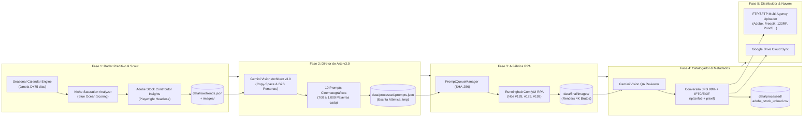

# StockCont 📈🤖

> **Plataforma Autônoma de Inteligência de Mercado Preditiva, Engenharia Reversa Multimodal, Produção Generativa em Massa 4K, Catalogação Binária IPTC/EXIF, Distribuição Multi-Agência e Dashboard Web SPA.**

[](https://www.python.org/)
[](https://fastapi.tiangolo.com/)
[](https://docs.pytest.org/)
[](https://playwright.dev/)
[](https://ai.google.dev/)
[](https://www.runninghub.ai/)
[](https://iptc.org/)
[](LICENSE)

---

## 📑 Sumário Executivo

1. [Visão Geral do Sistema](#-visão-geral-do-sistema)
2. [Arquitetura de Alto Nível & Topologia](#-arquitetura-de-alto-nível--topologia)
3. [Dashboard Web SPA Local (`http://localhost:8501`)](#-dashboard-web-spa-local)
4. [Detalhamento Técnico das 5 Fases do Pipeline](#-detalhamento-técnico-das-5-fases-do-pipeline)
   - [Fase 1: O Olheiro Preditivo (Radar Sazonal D+75 & Saturation Index)](#fase-1-o-olheiro-preditivo-radar-sazonal--saturation-index)
   - [Fase 2: O Diretor de Arte v3.0 (Prompts de 700–1.000 Palavras & Copy-Space)](#fase-2-o-diretor-de-arte-v30-prompts-de-7001000-palavras--copy-space)
   - [Fase 3: A Fábrica (Runninghub ComfyUI RPA, Fila SHA-256 & 4K)](#fase-3-a-fábrica-runninghub-comfyui-rpa-fila-sha-256--4k)
   - [Fase 4: O Catalogador (Multimodal QA, Injeção Binária IPTC/EXIF & CSV)](#fase-4-o-catalogador-multimodal-qa-injeção-binária-iptcexif--csv)
   - [Fase 5: O Distribuidor (SFTP/FTP Mass Upload Multi-Agência)](#fase-5-o-distribuidor-sftpftp-mass-upload-multi-agência)
   - [Módulo de Nuvem: Google Drive Asset Backup](#-módulo-de-nuvem-google-drive-asset-backup)
5. [Orquestrador Mestre CLI (`main.py`)](#-orquestrador-mestre-cli-mainpy)
6. [Estrutura do Repositório & Gestão de Dados](#-estrutura-do-repositório--gestão-de-dados)
7. [Contratos de Dados (Data Schemas v3.0)](#-contratos-de-dados-data-schemas-v30)
8. [Matriz Estratégica de Monetização Multi-Agência](#-matriz-estratégica-de-monetização-multi-agência)
9. [Instalação, Configuração & Execução](#-instalação-configuração--execução)
10. [Resiliência Operacional & Decisões de Engenharia](#-resiliência-operacional--decisões-de-engenharia)

---

## 🔭 Visão Geral do Sistema

O **StockCont** é um ecossistema autônomo de inteligência preditiva de dados e produção generativa industrial projetado para operar o ciclo comercial completo de ativos digitais criados por inteligência artificial para o mercado global de **microstock** (Adobe Stock, Freepik, Alamy, Vecteezy, Pond5, 123RF, Dreamstime).

Em vez de apostar em inspirações aleatórias ou geração descentralizada de baixo volume, o StockCont opera como um **fundo quantitativo de ativos visuais**:
1. **Antecipa a Demanda B2B Global (D+75 dias)**: Calcula as janelas de compra de grandes agências de publicidade e corporações através do **Seasonal Forecasting Radar** e audita a concorrência via **Niche Saturation Index** para atacar apenas mercados *Blue Ocean*.
2. **Engenharia Reversa Estética v3.0**: Decompõe as referências mais vendidas do mundo via Gemini Vision e sintetiza **prompts ultra-detalhados de 700 a 1.000 palavras**, incorporando física óptica, iluminação multi-ponto e **Copy-Space adaptativo** (35% a 50% de área livre para tipografia de marketing).
3. **Automação Robótica (RPA) no ComfyUI**: Opera o canvas LiteGraph no Runninghub para injetar lotes estruturados, capturar renders nativos em 4K e gerenciar a fila com livro-razão criptográfico SHA-256 anti-duplicação.
4. **Auditoria Visual & Metadados Físicos**: Converte ativos para JPG de alta fidelidade, audita defeitos anatômicos e **grava binariamente tags IPTC e EXIF** diretamente dentro do arquivo, garantindo auto-preenchimento instantâneo em qualquer agência.
5. **Distribuição Automatizada Multi-Protocolo**: Dispara uploads concorrentes via SFTP e FTP para as principais agências internacionais e mantém backup em nuvem sincronizado no Google Drive.
6. **Centro de Comando Web SPA**: Interface gráfica dark-theme (FastAPI) em tempo real para controle da esteira, galeria visual, inspeção de IPTC/EXIF e mineração preditiva com 1 clique.

---

## 🏗 Arquitetura de Alto Nível & Topologia



---

## 🖥️ Dashboard Web SPA Local

O StockCont conta com um **Dashboard Web em Single-Page Application (SPA)** moderno, de altíssima performance e com estética **Dark Theme** inspirada em terminais de dados financeiros e trading stations.

Para abrir o painel local:
```bash
python main.py --dashboard
```
*Acesse em seu navegador:* `http://localhost:8501`

### Seções da Interface:
* **Barra Superior de KPIs**: 6 cartões em tempo real exibindo Tendências mineradas, Prompts prontos, Fila ComfyUI (% de progresso), Imagens 4K em disco, Ativos catalogados com IPTC e Uploads distribuídos.
* **Pipeline Tracker**: Diagrama horizontal dinâmico com contadores e botões `▶ Run` para disparo granular de cada fase em background.
* **🖼️ Galeria de Ativos com Modal IPTC/EXIF**: Grid responsivo com thumbnails inteligentes de carregamento rápido. Ao clicar em qualquer imagem, inspeciona o título comercial, descrição e tags IPTC gravadas fisicamente no arquivo.
* **🔮 Radar Sazonal Interativo**: Apresenta os macro-temas e micro-nichos calculados pelo algoritmo de previsão para a próxima janela comercial (D+75 dias), com botão `🚀 Minerar este Nicho (Fase 1)` de 1 clique.
* **⏳ Gerenciador de Fila (Prompt Queue)**: Tabela paginada com hashes SHA-256 canônicos, status (`generated` / `pending`), timestamps e filtros.
* **🌐 Painel Multi-Agência**: Status de configuração e histórico de envios para as 7 plataformas suportadas.
* **📜 Timeline de Atividade**: Feed cronológico reverso com log de gerações e envios.
* **☁️ Sincronização Google Drive**: Monitoramento do status de backup em nuvem com botão `Sync Now`.

---

## 🔬 Detalhamento Técnico das 5 Fases do Pipeline

### Fase 1: O Olheiro Preditivo (*Radar Sazonal & Saturation Index*)
* **Módulos Centrais**: [`src/scraper/adobe_stock.py`](file:///c:/Users/WDAGUtilityAccount/Downloads/Nova%20pasta/stockcont/src/scraper/adobe_stock.py), [`src/analyzer/seasonal_radar.py`](file:///c:/Users/WDAGUtilityAccount/Downloads/Nova%20pasta/stockcont/src/analyzer/seasonal_radar.py), [`src/analyzer/saturation_index.py`](file:///c:/Users/WDAGUtilityAccount/Downloads/Nova%20pasta/stockcont/src/analyzer/saturation_index.py)
* **Objetivo**: Antecipar a demanda comercial das agências corporativas e filtrar nichos saturados antes de gastar recursos de GPU.

#### 1. Seasonal Demand Forecasting Radar (D+75 dias)
Empresas e agências de publicidade adquirem ativos para grandes campanhas com **60 a 90 dias de antecedência**:
* O motor calcula dinamicamente a data atual e projeta o trimestre-alvo de compras.
* Exemplo: Em outubro, o radar projeta a janela de **Janeiro/Fevereiro (Q1)**, priorizando nichos como *FinTech Analytics Dashboards*, *Biotech Longevity Labs* e *Relatórios Corporativos ESG*.
* Consulta via CLI:
  ```bash
  python main.py --seasonal
  ```

#### 2. Niche Saturation Index ($D / N$)
Calcula a relação matemática entre a velocidade de consumo e a concorrência existente:
$$\text{Saturation Score} = \frac{\text{Downloads Médios dos Top Sellers}}{\max(\text{Total de Resultados Indexados}, 1)}$$

* 🟢 **Blue Ocean** (Score $\ge 0.025$): Alta demanda e baixa concorrência. Produção prioritária com copy-space.
* 🟡 **Competição Moderada** ($0.005 \le \text{Score} < 0.025$): Mercado saudável que exige forte diferenciação estética.
* 🔴 **Red Ocean** (Score $< 0.005$): Nicho saturado. O sistema recomenda refinar para um micro-nicho.

---

### Fase 2: O Diretor de Arte v3.0 (*Prompts de 700–1.000 Palavras & Copy-Space*)
* **Módulo Central**: [`src/analyzer/director.py`](file:///c:/Users/WDAGUtilityAccount/Downloads/Nova%20pasta/stockcont/src/analyzer/director.py)
* **Objetivo**: Realizar a engenharia reversa das referências e produzir **exatamente 10 prompts cinematográficos ultra-densos (700 a 1.000 palavras por prompt)**, projetados com Copy-Space para compradores de alto valor.

#### As 6 Camadas de Densidade Cinematográfica:
1. **Spatial Architecture & Narrative Staging (120–150 palavras)**: Coordenadas espaciais 3D exatas, elementos de enquadramento em primeiro plano, sujeito no plano médio e profundidade atmosférica.
2. **Physical Materiality & Micro-Textures (120–150 palavras)**: Interações ópticas precisas: dispersão subsuperficial (*SSS*) em pele humana, micro-arranhões em alumínio escovado, reflexos de Fresnel em vidros arquitetônicos duplos e partículas de poeira capturando feixes de luz volumétricos.
3. **Multi-Point Lighting Architecture (120–150 palavras)**: Configuração de estúdio e luz natural: ângulos da luz principal (*Key*), softbox difuso, temperatura em Kelvin (ex: 3200K tungstênio vs 5600K luz do dia), proporção da luz de preenchimento (*Fill*), luz de contorno (*Rim/Kicker*) e cáusticas reflexivas.
4. **Optical Camera & Lens Fingerprint (100–130 palavras)**: Comportamento de lentes de cinema (35mm, 50mm, 85mm), aberturas físicas (f/1.4, f/2.8), curva de queda de foco suave, bokeh esférico natural sem artefatos sintéticos e granulação analógica tátil.
5. **Adaptive Copy-Space & Graphic Usability (120–150 palavras)**: Reserva intencional de 35% a 50% do enquadramento como área negativa limpa (com gradiente suave ou textura desfocada) para aplicação de títulos publicitários por designers gráficos.
6. **Commercial Buyer Intent & Compliance (100–120 palavras)**: Modelagem orientada a personas B2B (`ad_agency_hero`, `saas_landing_page`, `b2b_corporate_editorial`, `product_mockup`) e isenção total de marcas protegidas.

---

### Fase 3: A Fábrica (*Runninghub ComfyUI RPA, Fila SHA-256 & 4K*)
* **Módulos Centrais**: [`src/factory/runninghub_bot.py`](file:///c:/Users/WDAGUtilityAccount/Downloads/Nova%20pasta/stockcont/src/factory/runninghub_bot.py), [`src/factory/prompt_queue.py`](file:///c:/Users/WDAGUtilityAccount/Downloads/Nova%20pasta/stockcont/src/factory/prompt_queue.py)
* **Objetivo**: Automação em navegador real para preencher workflows complexos do ComfyUI, disparar geração em massa e capturar imagens 4K com upscale.

#### Destaques de Engenharia:
* **Gerenciador de Fila com Hashing SHA-256**: Cada prompt possui um hash canônico persistido em `data/processed/generation_history.json`, impedindo regerações duplicadas e garantindo reconciliação automática.
* **Processamento Multi-Lote Contínuo**:
  - `python main.py --phase 3 --batches 5` (executa 5 lotes de 10 prompts consecutivos na mesma sessão do browser).
  - `python main.py --phase 3 --all-batches` (processa todos os prompts pendentes até zerar a fila).
* **Captura Streaming no Nó #192 & Cancelamento Atômico**: Salva cada imagem 4K imediatamente antes que a próxima iteração sobrescreva o canvas e cancela a 11ª tarefa excedente na fila do Runninghub, economizando créditos de GPU.

---

### Fase 4: O Catalogador (*Multimodal QA, Injeção Binária IPTC/EXIF & CSV*)
* **Módulo Central**: [`src/cataloger/adobe_csv_maker.py`](file:///c:/Users/WDAGUtilityAccount/Downloads/Nova%20pasta/stockcont/src/cataloger/adobe_csv_maker.py)
* **Objetivo**: Auditoria de qualidade comercial, conversão de formatos e gravação física de metadados binários dentro do JPG.

| Protocolo / Padrão | Campo / Tag ID | Conteúdo Injetado | Plataformas que Reconhecem |
| :--- | :--- | :--- | :--- |
| **IPTC Core** | `2:05 (Object Name)` | Título comercial em inglês (< 200 caracteres) | Adobe Stock, Freepik, Shutterstock, Lightroom |
| **IPTC Core** | `2:25 (Keywords)` | Lista de **exatamente 50 tags** ordenadas por relevância | Adobe Stock, Freepik, Alamy, Vecteezy |
| **IPTC Core** | `2:120 (Caption)` | Descrição completa do ativo | Portais Web de Microstock |
| **EXIF IFD0** | `ImageDescription` | Título comercial formatado em UTF-8 | Windows Explorer, Mac Finder, Photoshop |
| **EXIF IFD0** | `0x9C9B (XPTitle)` | Título codificado em UTF-16LE | Windows Explorer Propriedades / Detalhes |
| **EXIF IFD0** | `0x9C9E (XPKeywords)`| Tags separadas por vírgula em UTF-16LE | Windows Explorer Propriedades / Detalhes |

> **Impacto Operacional**: Ao realizar upload manual ou via SFTP no portal Adobe Stock Contributor, **100% dos campos de formulário (Título, Tags e Categoria) são preenchidos instantaneamente pela plataforma**, eliminando trabalho braçal.

---

### Fase 5: O Distribuidor (*SFTP/FTP Mass Upload Multi-Agência*)
* **Módulo Central**: [`src/uploader/ftp_distributor.py`](file:///c:/Users/WDAGUtilityAccount/Downloads/Nova%20pasta/stockcont/src/uploader/ftp_distributor.py)
* **Objetivo**: Distribuição em escala para agências internacionais via protocolos de transferência de arquivos, com livro-razão de uploads em `upload_history.json`.

* **SFTP Seguro (`paramiko`)**: **Adobe Stock Contributor** (`sftp.contributor.adobestock.com:22`).
* **FTP/FTPS Seguro (`ftplib`)**: **123RF**, **Pond5**, **Freepik**, **Dreamstime**, **Alamy**, **Vecteezy**.
* **Modo de Simulação**: `python main.py --phase 5 --dry-run` para testar conexões e credenciais sem transferir arquivos.

---

### ☁️ Módulo de Nuvem: Google Drive Asset Backup
* **Módulo Central**: [`src/backup/gdrive_backup.py`](file:///c:/Users/WDAGUtilityAccount/Downloads/Nova%20pasta/stockcont/src/backup/gdrive_backup.py)
* **Modo Sincronização Local**: Compatível diretamente com o Google Drive para Desktop (`G:\Meu Drive\StockCont_backup`).
* **Histórico Atômico**: Registrado em `gdrive_backup_history.json`.
* **Disparo Automático**: Integrado ao final da Fase 4 e via CLI: `python main.py --backup`.

---

## 🎮 Orquestrador Mestre CLI (`main.py`)

```bash
# ==========================================
# DASHBOARD WEB SPA
# ==========================================
# Iniciar servidor local e abrir navegador automaticamente (http://localhost:8501):
python main.py --dashboard

# Iniciar servidor em background sem abrir o navegador:
python main.py --dashboard --no-browser --port 8501

# ==========================================
# RADAR SAZONAL PREDITIVO (D+75 DIAS)
# ==========================================
# Exibir previsão de demanda e nichos Blue Ocean da estação:
python main.py --seasonal

# ==========================================
# STATUS DO PIPELINE
# ==========================================
python main.py --status

# ==========================================
# FASE 1: OLHEIRO (SCRAPER & DEMANDA)
# ==========================================
# Minerar Contributor Insights dos Top Sellers mundiais:
python main.py --phase 1 --mode insights --type photo --max-items 20

# Minerar portfólios completos dos maiores contribuidores (--deep-profile):
python main.py --phase 1 --mode insights --deep-profile --max-items 30

# Buscar por nicho público específico ordenado por downloads:
python main.py --phase 1 --mode search --query "cybersecurity operations center" --order nb_downloads --max-items 15

# ==========================================
# FASE 2: DIRETOR DE ARTE v3.0 (700-1000 PALAVRAS)
# ==========================================
python main.py --phase 2

# ==========================================
# FASE 3: A FÁBRICA (RUNNINGHUB COMFYUI RPA)
# ==========================================
# Executar 1 lote de 10 prompts:
python main.py --phase 3 --node 192

# Executar 5 lotes consecutivos (50 imagens) na mesma sessão:
python main.py --phase 3 --batches 5

# Processar todos os prompts pendentes até zerar a fila:
python main.py --phase 3 --all-batches

# ==========================================
# FASE 4: O CATALOGADOR (METADADOS IPTC/EXIF)
# ==========================================
python main.py --phase 4

# ==========================================
# BACKUP EM NUVEM (GOOGLE DRIVE)
# ==========================================
python main.py --backup

# ==========================================
# FASE 5: DISTRIBUIÇÃO MULTI-AGÊNCIA
# ==========================================
# Simular envio (teste de credenciais):
python main.py --phase 5 --dry-run

# Upload para todas as agências configuradas:
python main.py --phase 5 --platform all

# Upload específico (ex: adobe, pond5, 123rf):
python main.py --phase 5 --platform adobe

# ==========================================
# PIPELINE COMPLETO END-TO-END
# ==========================================
python main.py --all --query "sustainable green energy architecture" --max-items 10
```

---

## 📂 Estrutura do Repositório & Gestão de Dados

```text
stockcont/
├── .env                              # Variáveis de ambiente (GEMINI_API_KEY, CREDENCIAIS FTP)
├── .env.example                      # Template de variáveis de ambiente
├── .gitignore                         # Regras de exclusão de binários e credenciais
├── main.py                           # Orquestrador CLI Mestre e Ponto de Entrada
├── README.md                         # Documentação técnica e arquitetura do projeto
├── requirements.txt                  # Dependências Python travadas
├── state.md                          # Quadro de estado e progresso das sprints
│
├── chrome_session/                   # Sessão persistente do Chrome para Fase 1
├── playwright_session/               # Sessão persistente do Chrome para Fase 3 (Runninghub)
│
├── data/
│   ├── raw/
│   │   ├── trends.json               # Dados minerados da Fase 1 (títulos, links, IDs)
│   │   └── images/                   # Previews baixados dos ativos em tendência
│   ├── processed/
│   │   ├── prompts.json              # Prompts comerciais v3.0 (700-1000 palavras)
│   │   ├── generation_history.json   # Livro-razão SHA-256 de geração da Fábrica
│   │   ├── upload_history.json       # Histórico de uploads FTP/SFTP multi-agência
│   │   ├── gdrive_backup_history.json# Histórico de sincronização do Google Drive
│   │   └── adobe_stock_upload.csv    # Planilha consolidada de backup para submissão
│   └── final/
│       ├── images/                   # Imagens 4K finais prontas com metadados IPTC/EXIF
│       └── rejected/                 # Imagens reprovadas no QA automático do Catalogador
│
├── src/
│   ├── analyzer/
│   │   ├── director.py               # Fase 2: Diretor de Arte v3.0 (700-1000 palavras)
│   │   ├── seasonal_radar.py         # Motor de Previsão de Demanda Sazonal (D+75 dias)
│   │   └── saturation_index.py       # Analisador de Saturação de Mercado (Blue Ocean)
│   ├── backup/
│   │   └── gdrive_backup.py          # Módulo de Backup em Nuvem Google Drive
│   ├── cataloger/
│   │   └── adobe_csv_maker.py        # Fase 4: Catalogador (IPTC, EXIF, QA & CSV)
│   ├── dashboard/
│   │   ├── app.py                    # Servidor FastAPI e rotas REST do Dashboard
│   │   ├── readers.py                # Leitores seguros de dados do pipeline
│   │   ├── runner.py                 # Executor assíncrono de fases via subprocess
│   │   └── static/                   # SPA Frontend (HTML, CSS Dark Theme, JavaScript)
│   ├── factory/
│   │   ├── prompt_queue.py           # Gestor de Fila e Livro-Razão SHA-256
│   │   └── runninghub_bot.py         # Fase 3: A Fábrica (Controller RPA ComfyUI)
│   ├── scraper/
│   │   └── adobe_stock.py            # Fase 1: Olheiro Playwright (Insights & Busca)
│   └── uploader/
│       └── ftp_distributor.py        # Fase 5: Distribuidor SFTP/FTP Multi-Agência
│
└── tests/
    ├── test_dashboard.py             # 10 testes de endpoints e integridade da SPA
    ├── test_distributor.py           # 6 testes de protocolos e credenciais de agências
    ├── test_gdrive_backup.py         # 6 testes de sincronização em nuvem
    ├── test_pipeline_e2e.py          # 5 testes de integração de ponta a ponta
    ├── test_predictive_intelligence.py # 5 testes do Radar Sazonal e Saturation Index
    └── test_prompt_queue.py          # 12 testes do gestor de fila e hashing SHA-256
```

---

## 📄 Contratos de Dados (Data Schemas v3.0)

### Schema de Prompts Gerados (`data/processed/prompts.json` - v3.0)
```json
[
  {
    "source_id": "2090056954",
    "source_title": "Faceless business team reviewing financial dashboards...",
    "system_version": "3.0",
    "analysis_metadata": {
      "reference_available": true,
      "target_model": "model-agnostic-flux-comfyui",
      "commercial_category": "Stock photography",
      "asset_vocation": "tech_corporate",
      "analysis_confidence": 0.95
    },
    "analysis": {
      "style": "Cinematic commercial realism, corporate aesthetics",
      "lighting": "Low-key interior with cyan monitor illumination and warm bokeh",
      "composition": "Rule of thirds, wide copy-space reserve",
      "color_palette": {
        "description": "Deep navy and dark slate with high-contrast cyan highlights",
        "dominant_colors": [
          {"name": "Deep Slate", "hex_estimate": "#1E293B", "role": "dominant"}
        ]
      },
      "materials_and_textures": "Anti-reflective glass, brushed aluminum, matte paper",
      "mood": "Focused, analytical, professional",
      "copy_space_profile": "Left 40% reserved for headline typography"
    },
    "generated_prompts": [
      {
        "id": 1,
        "concept": "FinTech High-Frequency Trading Desk & Analytics",
        "creative_direction": "Wide cinematic shot with left-third copy-space",
        "layout_type": "left_third_copy_space",
        "copy_space_zone": "left_35_percent",
        "target_buyer": "saas_landing_page",
        "copy_space_description": "Clean dark architectural concrete wall softly illuminated by diffused cyan LED glow, creating pristine negative space for typography.",
        "commercial_use_cases": ["Fintech websites", "Banking reports", "SaaS hero headers"],
        "prompt": "Cinematic wide commercial shot of a high-tech financial operations workstation... [700 a 1.000 palavras descrevendo física de materiais, iluminação Kelvin, lente 50mm f/1.4 e copy-space]",
        "prompt_data": {
          "subject": "Trading interface workstation with glowing candlestick telemetry",
          "environment": "Late night corporate trading room with ambient reflections",
          "composition": "Rule of thirds, subject on right third, left third clean copy space",
          "lighting": "Emissive blue monitor glow with warm background bokeh at 3200K",
          "style": "Hyperrealistic commercial photography",
          "color_palette": "Deep navy, cyan, fluorescent green, dark carbon",
          "materials_and_textures": "Brushed aluminum, illuminated pixels, anti-reflective glass",
          "mood": "High-stakes, high-tech, precise",
          "technical_qualifiers": ["8k resolution", "sharp focus on glass", "photorealistic", "left copy-space"],
          "negative_prompt": "blurry, anatomical defect, text watermark, distortion",
          "final_prompt": "Cinematic wide commercial shot of a high-tech financial operations workstation... [700 a 1.000 palavras]"
        },
        "estimated_word_count": 820,
        "reference_fidelity": 0.92,
        "conceptual_distinctiveness": 0.88,
        "commercial_suitability": 0.98
      }
    ]
  }
]
```

---

## 🌐 Matriz Estratégica de Monetização Multi-Agência

| Nível de Mercado | Plataforma | Repasse / Royalty | Política de IA | Método de Ingestão |
| :--- | :--- | :--- | :--- | :--- |
| **Tier Ouro (Alto Volume)** | **Adobe Stock** | 33% por download | ✅ Totalmente Aceito *(Marcar checkbox IA)* | SFTP nativo / Lê IPTC automático |
| **Tier Ouro (Alto Volume)** | **Freepik Contributor** | Modelo pool por download | ✅ Aceito em escala massiva | FTP nativo / Lê IPTC automático |
| **Tier Ouro (Alto Volume)** | **Vecteezy** | Pagamento por download | ✅ Aceito (Imagens & Vetores) | FTP nativo / Lê IPTC automático |
| **Tier Prata (Volume Médio)**| **123RF** | 30% a 50% de comissão | ✅ Aceito | FTP nativo / Lê IPTC automático |
| **Tier Prata (Volume Médio)**| **Dreamstime** | 25% a 50% de comissão | ✅ Aceito | FTP nativo / Lê IPTC automático |
| **Tier Prata (Volume Médio)**| **Depositphotos** | 30% a 44% de comissão | ✅ Aceito | FTP nativo / Lê IPTC automático |
| **Macrostock (High-Ticket)**| **Alamy** | 40% a 50% (vendas de $20 a $150+) | ✅ Aceito *(Declarar IA nos metadados)* | SFTP nativo / Lê IPTC automático |
| **Macrostock (High-Ticket)**| **Pond5** | 40% *(Criador define o preço)*| ✅ Aceito | FTP nativo / Lê IPTC automático |

---

## 🚀 Instalação, Configuração & Execução

### 1. Pré-Requisitos
* Python 3.11 ou superior
* Google Chrome instalado
* Chave de API ativa do Google Gemini ([Google AI Studio](https://aistudio.google.com/))

### 2. Configuração do Ambiente
```bash
# 1. Clonar o repositório
git clone https://github.com/ciamarrojonatan-droid/stockcont.git
cd stockcont

# 2. Criar e ativar o ambiente virtual
python -m venv venv

# Windows PowerShell:
.\venv\Scripts\Activate.ps1

# Linux / macOS:
source venv/bin/activate

# 3. Instalar dependências e navegadores do Playwright
pip install -r requirements.txt
playwright install chromium
```

### 3. Executando os Testes Automatizados
```bash
pytest
```
*Resultado esperado:* **44 passed in ~1.1s (100% verde)**.

### 4. Abrindo o Dashboard Web
```bash
python main.py --dashboard
```

---

## 🛡 Resiliência Operacional & Decisões de Engenharia

1. **Blindagem de Encoding UTF-8 em Windows**: Todo I/O de console, rede e persistência é forçado para UTF-8 no bootstrap de `main.py` e utilitários, neutralizando falhas crônicas de `cp1252`.
2. **Escrita Atômica Transacional**: Todos os arquivos JSON críticos (`prompts.json`, `trends.json`, `generation_history.json`, `upload_history.json`) são serializados primeiramente em arquivos temporários `.tmp` e substituídos atomicamente via `replace()`.
3. **Fila Criptográfica com Hashing SHA-256**: Cada prompt gera um hash canônico único, garantindo idempotência e prevenindo que lotes parciais reexecutem prompts já renderizados.
4. **Isolamento de Sessões do Navegador**: O projeto divide os estados do navegador entre `chrome_session` (autenticação de usuário no portal Adobe Stock) e `playwright_session` (autenticação de infraestrutura no Runninghub ComfyUI), impedindo colisão de cookies.
5. **Backoff e Timeout Resiliente**: Chamadas para o Gemini Vision contam com timeout de 120s para comportar prompts de 700 a 1.000 palavras e lógica de retentativa automática contra códigos HTTP 429 e 503.

---

## 📜 Licença

Distribuído sob a licença **MIT**. Consulte o arquivo `LICENSE` para mais informações.
